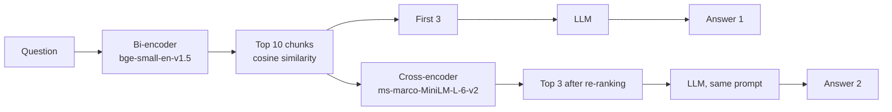

# RAG on the Laws of Cricket: Baseline vs. Cross-Encoder Re-Ranking

Two retrieval pipelines for question answering over one complex document, the
**MCC Laws of Cricket (2017 Code, 4th Edition, 2026)**. Both use the same chunks, the same LLM and the same prompt;
the only difference is whether a cross-encoder re-ranks the retrieved chunks before they reach the LLM.

All code is in one notebook: [`rag_cricket.ipynb`](rag_cricket.ipynb). How to run it is at the end.

## Setup



| Component | Choice |
|---|---|
| Document | MCC Laws of Cricket PDF (90 pages); pages 5–82 used (Preamble, Laws 1–42, Appendices A–B). Contents page and index dropped: they list every Law title and would match almost any query. |
| Chunks | One per numbered clause (e.g. *21.17 Out from a No ball*), max 200 tokens, each starting with its Law and clause title. **432 chunks.** |
| Bi-encoder | `BAAI/bge-small-en-v1.5` (384 dimensions); queries get the bge instruction prefix. |
| Vector store | numpy matrix (432 × 384), normalised so dot product = cosine similarity. |
| Cross-encoder | `cross-encoder/ms-marco-MiniLM-L-6-v2` on the 10 (query, chunk) pairs. |
| LLM | `nvidia/nemotron-3.5-super-vl:free` via OpenRouter, temperature 0. |
| Prompt | Answer **only** from the passages and quote them; reply "The context does not say." if nothing covers the question; say so if only exceptions are present. Slang may be matched to the passage that describes it, but the rule must come from the passage. |

**Does the LLM use the passages or its own memory?** With three unrelated passages, "How many balls are there in an
over?" gets *"The context does not say."*; with "3 minutes" changed to "5 minutes" in the Timed out passage, it answers
5 minutes. So a missing chunk shows up in the answer instead of being hidden by the model's own cricket knowledge.

---

## 1. Architecture comparison

- **Bi-encoder (independent embeddings, cosine similarity).** The query and each chunk are encoded **separately** into
  vectors and compared with cosine similarity. Chunk vectors are computed once in advance, so a search is one fast
  matrix product. But the query and the chunk never see each other: everything about a chunk is squeezed into one
  vector before the question is known, so details like which side of a rule, an exception, a negation, or slang vs.
  official wording can be lost.
- **Cross-encoder (joint self-attention across tokens).** The query and a chunk are fed **together** into one
  transformer, so every query token can attend to every chunk token, and the model outputs one relevance score for
  the pair. This judges relevance more precisely, but nothing can be precomputed: it must run once per (query, chunk)
  pair at query time.

---

## 2. Qualitative & rank shift analysis

### How the failure queries were found

86 questions were written across the brief's categories (keyword trap, exception, negation, buried chunk) plus everyday
wording and cricket slang. For each, the clause that actually answers it (the "gold" clause) was looked up, and we
checked whether each pipeline puts it in the top 3 the LLM sees:

| Outcome (86 queries) | Count |
|---|---|
| Both pipelines have the gold chunk in the top 3 | 46 |
| **Re-ranking helps** (only Pipeline 2 has it) | **6** |
| **Re-ranking hurts** (only Pipeline 1 has it) | **8** |
| Neither has it | 26 |

Most negation and exception questions were already handled by the bi-encoder, because the clause titles in the chunk
headers share many words with such questions. Re-ranking helped mainly when the question used **words the Laws never
use** (slang).

### Rank changes

- **Mankad** (keyword trap): chunk 318 (*38.3 Non-striker leaving their ground early*) moved from **#7 → #1**. The
  baseline's top 3 shared the query's words but not the rule (*30.3 Position of non-striker*, *32.1 Out Bowled*,
  *21.4 Bowler throwing towards striker's end before delivery*).
- **Beamer** (buried chunk): chunk 348 (*41.7 Dangerous and unfair non-landing deliveries*) moved from **#5 → #2**, and
  chunk 344 (*41.6 Dangerous and unfair short deliveries*) from **#8 → #3**.
- **Bad light** (synonym): chunk 13 (*2.7 Fitness for play*) moved from **#7 → #3**.
- **Grubber** (slang): chunk 195 (*21.7 Ball bouncing more than once, rolling along the ground…*) moved from **#5 → #1**.
- **Slow over rate** (slang): chunk 352 (*41.9 Time wasting by the fielding side*) moved from **#9 → #1**, and its
  second part, chunk 353, from **#4 → #2**.
- **Counterexample, negation** ("When can byes **not** be scored?"): chunk 215 (*23.1 Byes*) moved **down** from
  **#2 → #6**; the cross-encoder preferred *23.3 Leg byes not to be awarded*.
- **Counterexample, exception** ("Can a batter be given out for hitting the ball a second time on purpose?"):
  chunk 295 (*34.1 Out Hit the ball twice*) moved **down** from **#1 → #5**; the cross-encoder preferred the *Not out*
  clauses (37.2, 34.2).

### Answer 1 vs. Answer 2

| Query | Answer 1 (baseline) | Answer 2 (re-ranked) | What went wrong in the weaker answer |
|---|---|---|---|
| Mankad | "The context does not say." | Correct: the non-striker can be run out until the bowler's arm reaches the top of the bowling action (38.3) | Omitted essential clause (Answer 1) |
| Beamer | "The context does not say." | Matches beamer to 41.7: a deliberate one is a No ball and the bowler is suspended | Omitted essential clause (Answer 1) |
| Bad light | Yes, but only from indirect clauses about stoppages and the end of a match | Yes, and adds that the umpires decide fitness for play (2.7) | Omitted clause, mild (Answer 1 incomplete) |
| Grubber | "The context does not say." | Correct: it is a No ball (21.7.1) | Omitted essential clause (Answer 1) |
| Slow over rate | "The context does not say." | Correct: first and final warning, then 5 penalty runs or the bowler is suspended (41.9) | Omitted essential clause (Answer 1) |
| Byes not scored | Correct: not off a Wide, or when the ball touches the batter (23.1) | "The context does not say." | Omitted essential clause (Answer 2) |
| Hit ball twice | Correct: out, unless it is only to guard the wicket (34.1) | Lists only the *not out* exceptions and says the main rule is missing | Omitted essential clause (Answer 2) |

**Hallucination, omitted clause or misstated rule?** In every case the weaker answer **omitted an essential clause**
because the critical chunk was outside its top 3. There were **no hallucinations and no misstated rules**: the strict
prompt made the LLM refuse, or say what was missing, instead of filling the gap. The beamer case also shows the prompt's
limit: before slang matching was allowed, the LLM refused even when re-ranking had put 41.7 in its context.

### How often does re-ranking help? (all 86 queries)

| Chunks | Pipeline | Hit @1 | Hit @3 | MRR | Recall @10 |
|---|---|---|---|---|---|
| **With** headers (main setup) | Baseline | 0.477 | 0.628 | 0.572 | 0.791 |
| | Re-ranked | 0.488 | 0.605 | 0.571 | 0.791 |
| **Without** headers (experiment) | Baseline | 0.372 | 0.605 | 0.499 | 0.767 |
| | Re-ranked | 0.453 | 0.593 | 0.545 | 0.767 |

With headers, re-ranking is roughly neutral overall: the headers already do much of the work a re-ranker would do.
Without them the bi-encoder is clearly worse and re-ranking recovers part of the gap. About one query in five never has
the right chunk in the top 10 at all, which no re-ranker can fix. A wider pool (top 30) or a larger cross-encoder
(MiniLM-L-12) changed only one or two outcomes while making re-ranking about 2× to 10× slower (notebook section 6.9).

---

## 3. Latency profiling

CPU only. Retrieval and re-ranking: 10 queries × 5 repeats after a warm-up. End to end: 5 queries × 2 pipelines with
real API calls (no answer cache).

| Stage | Mean | Median | Min | Max |
|---|---|---|---|---|
| Query embedding (bi-encoder) | 26.6 ms | 27.9 ms | 18.3 ms | 34.3 ms |
| Vector search (432 chunks) | 0.2 ms | 0.2 ms | 0.1 ms | 0.2 ms |
| Cross-encoding (10 pairs) | 310.7 ms | 313.4 ms | 269.5 ms | 349.8 ms |
| LLM generation | 21.5 s | 8.4 s | 2.3 s | 128.7 s |
| **Baseline retrieval** (Pipeline 1 without LLM) | **26.8 ms** | **28.1 ms** | 18.4 ms | 34.5 ms |
| **Retrieval + re-ranking** (Pipeline 2 without LLM) | **337.5 ms** | **341.2 ms** | 296.8 ms | 380.9 ms |
| End to end, Pipeline 1 | 36.2 s | 12.0 s | 5.0 s | 128.9 s |
| End to end, Pipeline 2 | 7.3 s | 4.6 s | 2.6 s | 14.4 s |

One-off cost before any query: building the index for 432 chunks took 26.4 s.

- **Re-ranking makes retrieval about 12× slower** (≈ 27 ms → ≈ 340 ms), because the cross-encoder runs a full model pass
  for each of the 10 pairs, while the bi-encoder embeds one short query and does one matrix product.
- **The LLM dominates the end-to-end time.** Using medians (the free-tier API had outliers of up to 129 s), a typical
  question takes ≈ 8.5 s with Pipeline 1 and ≈ 8.8 s with Pipeline 2, so re-ranking adds only about 4% end to end.
- The end-to-end means are misleading here: one Pipeline 1 call waited 129 s in the API queue. That has nothing to do
  with the pipeline, which is why the medians are the fairer comparison.

---

## 4. Scaling question: why not run the cross-encoder over the whole collection?

- A cross-encoder needs the query and the chunk **together**, so nothing can be computed in advance: every new query
  needs one full model pass **per chunk**.
- Here, 10 pairs take ~310 ms. Scoring all 432 chunks would take about 43× that (≈ 13 s per query on this CPU) before
  the LLM even starts, and a real collection of thousands or millions of chunks would be far slower. Our pool experiment
  shows the same growth: 10 → 30 pairs took about 3× as long.
- A bi-encoder pays its cost once: all 432 chunk vectors took ~25 s to build, and after that a search over all of them
  takes under a millisecond.
- So the two stages divide the work: the cheap bi-encoder narrows the whole collection down to a short list, and the
  expensive but more precise cross-encoder only re-orders that short list.

---

## Limitations

- The gold clauses for the 86 screening queries were chosen by hand.
- One document and 86 queries; the 7 cases above were selected from the screening, so they show *how* re-ranking can
  help or hurt, while the counts and metrics show *how often*.
- The `ms-marco` cross-encoders were trained on web search, not rulebooks, which shows in the negation cases.
- Free-tier LLM: response times vary a lot and answers are not perfectly deterministic (they are cached).

## How to run

1. Python 3.12, then:
   ```bash
   pip install -r requirements.txt
   ```
2. Create a free [OpenRouter](https://openrouter.ai) API key and put it in a file called `.env` next to the notebook:
   ```
   OPENROUTER_API_KEY=your-key-here
   ```
3. Open `rag_cricket.ipynb` and run all cells. The Laws PDF is downloaded automatically from lords.org on the first run;
   it is not in this repository because the text is MCC copyright. Generated files (chunks, index, cached answers) go to
   `output/`, which is also not committed.
